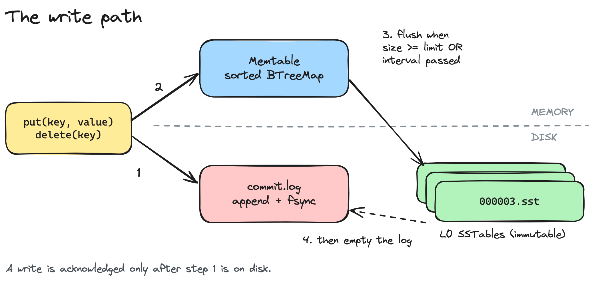
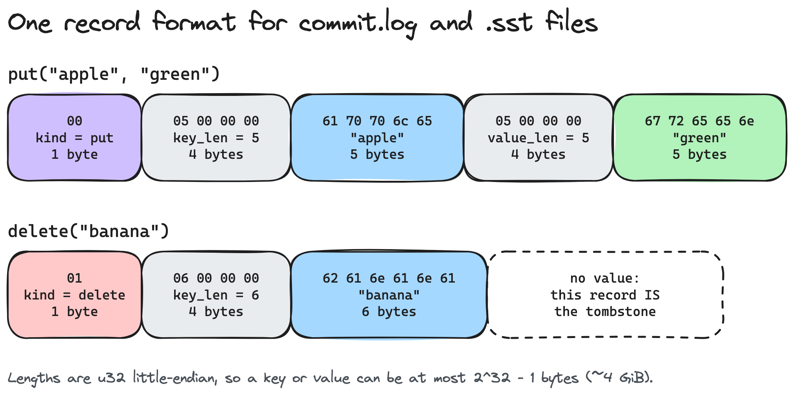
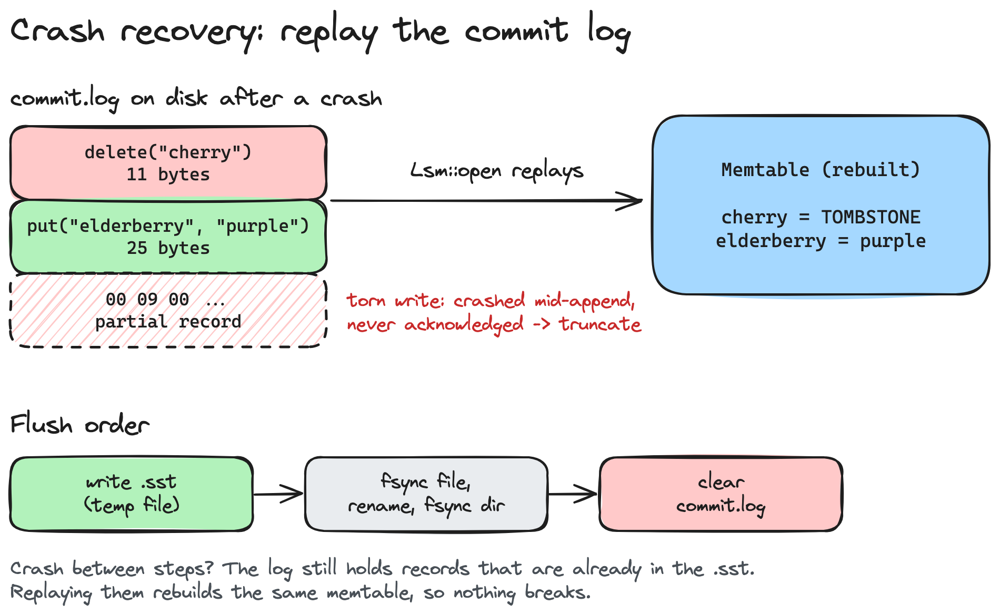
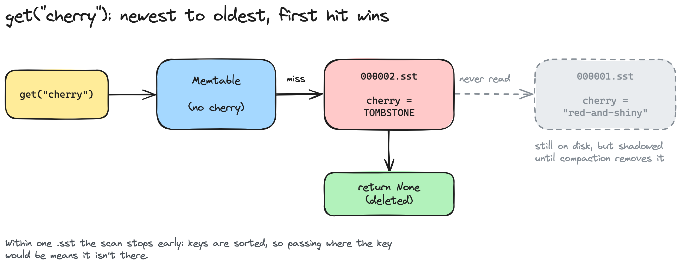

*Draft for Medium. Publishing notes: set the first line as Medium's Big Title (T) and the second as its Subtitle (t). Upload the PNGs from `diagrams/` where marked. Tags (5): Programming, Software Engineering, Databases, Rust, Distributed Systems. Consider submitting to a programming publication that's open to submissions.*

---

# Deleting a Key Made My Database Bigger

## Building a Database from Scratch, Part 1: a tiny LSM storage engine in 350 lines of Rust

In the database I just built, `delete("cherry")` makes the data on disk **bigger**.

That's not a bug. It's how the storage engines inside Cassandra, RocksDB and Bigtable work.

If you use any of them, this is what happens to your writes. Here's why, one piece at a time.

---

## The one idea: never update in place

Updating a record on disk means finding where it lives and rewriting it there. All that jumping around is slow.

A **log-structured merge tree** (LSM tree) never does it:

- Writes go into a sorted structure **in memory**.
- When that fills up, it's written to disk in one go, as a file that is **never modified again**.
- Reads check memory first, then the files from newest to oldest.

Every disk write is an append. Reads pay the price instead, because they may have to look in sct everal places.



---

## 1. The memtable: a sorted map that knows its size

Writes land in the **memtable**. It must keep keys sorted, because it becomes a sorted file later.

Rust's `BTreeMap` does exactly that. Iterating over it always visits keys from smallest to largest, so flushing it is just one loop.

Keys are raw bytes, compared byte by byte, which gives some surprising orders:

> `"Zebra"` sorts before `"apple"`, and `"10"` sorts before `"9"`.

If you store numbers as keys, encode them big-endian so byte order matches numeric order.

### The size-counting trap

The memtable tracks its size so it knows when to flush. Overwriting a key must **replace** the old value's bytes, not add to them:

```rust
fn insert(&mut self, key: Vec<u8>, value: Option<Vec<u8>>) {
    let key_len = key.len();
    let value_len = value.as_ref().map_or(0, Vec::len);
    match self.entries.insert(key, value) {
        Some(old_value) => {
            self.size_bytes = self.size_bytes + value_len - old_value.map_or(0, |v| v.len())
        }
        None => self.size_bytes += key_len + value_len,
    }
}
```

Get this wrong and writing one key a thousand times counts it a thousand times.

### When to flush

My first idea was to flush on a timer. Bigtable flushes on size. I kept both: flush when the memtable passes a size limit **or** an interval passes, whichever comes first.

---

## 2. SSTables: write once, never touch again

An **SSTable** (Sorted String Table) is the memtable written to a file in key order. Each record is a kind byte (put or delete), then the key and value, each with its length in front:



### Four steps to write a file safely

A crash mid-write must never leave a half-written file that looks real:

1. Write everything to a temp file.
2. `fsync` it, so the bytes are actually on disk, not just in the OS cache.
3. `rename` it to `.sst`. A rename is atomic: you see the old name or the new one, never anything in between.
4. `fsync` the **directory**.

```rust
file.sync_all()?;
fs::rename(&temp_path, path)?;
if let Some(dir) = path.parent() {
    File::open(dir)?.sync_all()?;
}
```

> Step 4 is easy to miss. Without it, the file's bytes can be safely on disk while its new name isn't.

---

## 3. The commit log: surviving a crash

Writes that haven't been flushed live only in memory. Kill the process and they're gone, even though `put` already returned `Ok`.

The fix is a **commit log**, also called a write-ahead log: every write is appended to a file and synced to disk *before* it touches the memtable.

```rust
pub fn put(&mut self, key: Vec<u8>, value: Vec<u8>) -> io::Result<()> {
    self.log.append(&key, Some(&value))?;
    self.memtable.put(key, value);
    self.flush_if_needed()
}
```

On startup, the store replays the log into a fresh memtable, rebuilding exactly what was in memory before the crash.



### Three crash-safety details

**Torn writes.** A crash mid-append leaves a fragment of a record at the end of the log. That write was never acknowledged, so recovery trims the file back to the last complete record.

**Flush order.** The SSTable must be fully on disk before the log is emptied. Reverse the two, crash in between, and the data is gone.

**Crashing between the steps anyway.** Then the log holds records that are already in the SSTable. Replaying them rebuilds the same memtable, so nothing breaks.

> Making recovery safe to repeat is easier than making every step perfectly ordered.

The cost: every `put` waits for the disk. To get around this systems use **group commit**, which batches many writes into one sync.

---

## 4. Tombstones: deleting from a file you can't change


Here's the strange part. If `cherry` lives in an immutable file, you can't remove it from that file.

Removing it from the memtable isn't enough either. The next read would miss the memtable, check the file, and find the old value again.

So a delete **writes a new record**, a *tombstone*, that says "this key is gone."



Reads still go newest to oldest, and the first hit wins. A tombstone is a hit that says "stop, it's deleted." In Rust that fits into nested `Option`s:

- `None`: this table has never seen the key, so keep looking
- `Some(None)`: tombstone, the key is deleted
- `Some(Some(value))`: found it

```rust
pub fn get(&self, key: &[u8]) -> io::Result<Option<Vec<u8>>> {
    if let Some(value) = self.memtable.get(key) {
        return Ok(value.map(<[u8]>::to_vec));
    }
    for table in self.level0.iter().rev() {
        if let Some(value) = table.get(key)? {
            return Ok(value);
        }
    }
    Ok(None)
}
```

And that's the answer to the title. After a delete, the old value **and** the tombstone are both on disk. Neither goes away until **compaction** merges the files.

---

## Proof it works

The demo runs every piece, including a simulated crash:

```
after crossing 32 bytes (expect 1 file): ["000001.sst"]
get cherry after delete (expect None, though 000001.sst still has it): None
simulated a crash mid-append: commit.log grew from 36 to 39 bytes
after reopening, commit.log is back to 36 bytes
get elderberry (expect "purple", replayed from the log): Some("purple")
```

The code is std-only Rust: [github.com/Ilhan-Personal/database-internals](https://github.com/Ilhan-Personal/database-internals), in `experiments/02-sstables`.

---

## Next in the series

Part 2 deals with the leftovers: **compaction**, which merges the files and finally clears out those tombstones. Follow along if you want to see the database get smaller again.

After that:

- **Block index:** stop scanning whole files. Bigtable uses 64 KB blocks plus an index, so a lookup costs one disk seek.
- **Bloom filters:** skip files that definitely don't have the key.
- **Checksums:** detect corrupted bytes, not just cut-off ones.


---

**References**

- Chang et al., [*Bigtable: A Distributed Storage System for Structured Data*](https://research.google.com/archive/bigtable-osdi06.pdf), OSDI 2006
- O'Neil et al., *The Log-Structured Merge-Tree (LSM-Tree)*, Acta Informatica, 1996
- Alex Petrov, *Database Internals*, O'Reilly, 2019
